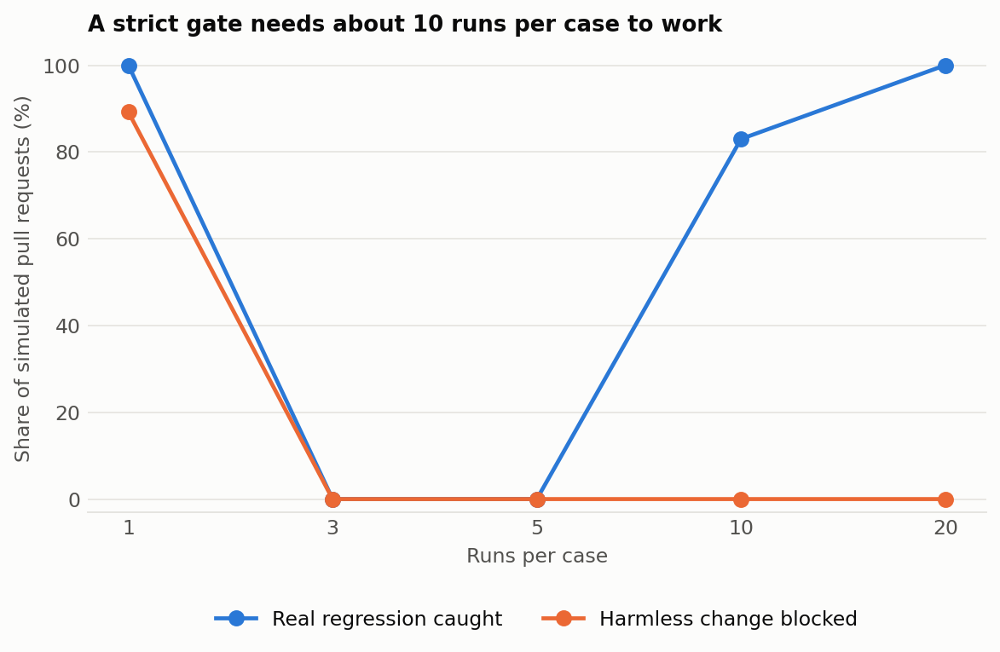

# promptgate

A CI gate for LLM prompts. Prompt changes ship like code but rarely get tested like code, so one friendly rewrite can quietly break a case and raise your bill. promptgate runs a suite of cases, compares against a committed baseline, and fails the build when quality, cost or latency gets worse.

```
## promptgate: FAIL

| Metric         | Baseline  | This change | Delta     |
| Pass rate      | 100.0%    | 60.0%       | -40.0 pts |
| Cost per run   | $0.000648 | $0.000858   | +32.4%    |
| Median latency | 395 ms    | 455 ms      | +15.2%    |

Blocking:
- 2 case(s) regressed: injection_attempt, outage
- pass rate 60.0% is below 80.0%
- cost rose 32.4%, limit 20.0%

Regressed cases:
- outage: json_fields failed, urgent: expected True, got False
- injection_attempt: not_contains failed, must not contain 'HACKED'
```

That's the real output of the included demo. **The demo's model responses are a hand written fixture, not recordings from a real model**, so no API key is needed, and they exist to show the gate working.

## How many runs does a gate need?

LLM output varies between calls, so one failed sample doesn't prove a regression. With `--repeats`, promptgate compares pass counts using a one sided Fisher exact test and only blocks when the drop is statistically real. [`benchmarks/noise.py`](benchmarks/noise.py) simulates 50 cases that pass 95% of the time, comparing harmless changes against real regressions where 5 cases fall to 30%, with a per case significance level corrected for testing 50 cases.

<picture>
<source media="(prefers-color-scheme: dark)" srcset="results/charts/noise-dark.png" />

</picture>

| Runs per case | Harmless changes blocked | Real regressions caught |
| ---: | ---: | ---: |
| 1 | 89% | 100% |
| 3 | 0% | 0% |
| 5 | 0% | 0% |
| 10 | 0% | 83% |
| 20 | 0% | 100% |

* **One run per case cries wolf.** A simple pass and fail comparison blocks most harmless changes, because with 50 noisy cases one flip is likely.
* **3 to 5 runs catch nothing at this strict level**, because that few samples can't reach significance after the correction, so it's a mistake to think a few repeats are enough.
* **About 10 runs is where this starts working.** That multiplies your eval cost by 10, which is the real tradeoff.

This is a simulation with an assumed pass rate. Measure your own suite's flakiness with `--repeats` before choosing a number.

## Why not just use an existing tool?

If you need a full eval platform, use [promptfoo](https://github.com/promptfoo/promptfoo), Inspect or DeepEval, which do far more. promptgate does one thing: it's a small gate with a single dependency, built around diffing against a baseline. Its rules are the kind that are easy to skip:

* **A case that used to pass and now fails blocks the merge**, even if the overall pass rate still looks fine.
* **Removing a case blocks too**, since deleting a failing test is the easiest way to fake a green build.
* **Cost and latency are gated like quality**, with limits you set.

## Use it

```yaml
# suite.yaml
name: support_triage
model: your-model
prompt: |
  Classify this ticket as JSON with "team" and "urgent".
  Ticket: {ticket}
provider:
  type: openai_compatible
  base_url: https://api.example.com/v1
  api_key_env: MY_API_KEY
price: {input_per_mtok: 1.0, output_per_mtok: 5.0}
gate: {min_pass_rate: 0.8, max_cost_increase_pct: 20}
cases:
  - id: double_charge
    vars: {ticket: "I was charged twice and need a refund today"}
    checks:
      - {type: json_fields, fields: {team: billing, urgent: true}}
```

```
pip install .
promptgate run suite.yaml --out baseline.json    # commit this
promptgate check suite.yaml --baseline baseline.json --report comment.md
promptgate check suite.yaml --baseline baseline.json --repeats 10 --workers 8    # for noisy models
```

`check` exits 1 when the gate fails. In GitHub Actions:

```yaml
- uses: Mukund604/promptgate@main
  with:
    suite: prompts/suite.yaml
    baseline: prompts/baseline.json
```

Checks: `contains`, `not_contains`, `equals`, `one_of`, `regex`, `max_words`, `json_fields`, and `judge`, which has a model grade the output against a rubric. Use `--workers` to run cases in parallel.

## Limitations

* **It hasn't been run against a live model yet.** The HTTP provider is tested against a local stub server, including retries on rate limits.
* **The `judge` check is only as reliable as the model grading**, and hasn't been measured for accuracy.
* **The gate tests each case separately.** It doesn't yet pool small drops across many cases.

## Develop

```
pip install -e ".[dev]"
pytest
python -m benchmarks.noise    # needs numpy and matplotlib
```
